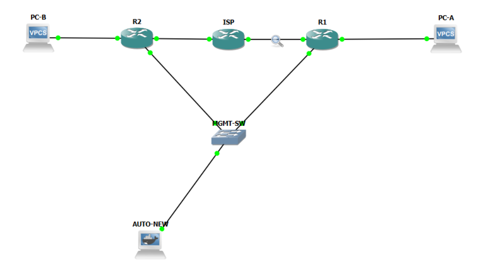

<h1 align="center">🔐 ITT633: Python-Based Deployment and Verification of a
Site-to-Site IPsec VPN</h1>

<p align="center">
  <strong><em>Python Automation for Secure Headquarters-to-Branch Connectivity</em></strong>
</p>
<p align="center">
  <strong>ITT633 Network Automation Group Project</strong><br>
  <em>Configure · Deploy · Verify · Document</em>
</p>

<p align="center">
  <a href="https://drive.google.com/drive/folders/1ZHm2lVKo7zREB6UgLldnr5i8v4OFODHI"></a>
  <a href="https://drive.google.com/drive/folders/17XaOv7ST13VQTleBFFjlIGdAJMaN2yV2"></a><br>
  <a href="https://drive.google.com/drive/folders/1HHBe39INT3iOcPWBcgI1LAFGo_WxDH4m"></a>
  <a href="https://drive.google.com/drive/folders/119CFqLdhxbQdeTu18pONOXM7nYWrbDXl"></a>
  <a href="https://drive.google.com/drive/folders/1flZ4yWAGp2Pfmj3AC3P0KxS9KVwuCNgY"></a>
</p>

<br>

<p align="center"><strong>Python · Netmiko · YAML · Jinja2 · Cisco IOS XE · GNS3</strong></p>
<p align="center">IKEv2 &amp; IPsec · Configuration Deployment · Fault Detection · Network Verification</p>

---

## Overview

Python configuration generation and SSH deployment for an HQ-to-branch IPsec VPN in GNS3. The lab uses two Cisco CSR1000v routers, an ISP transit router and a separate management network.

<p align="center">
  <a href="#network-topology">Topology</a> ·
  <a href="#shared-lab-resources-google-drive">Lab Resources</a> ·
  <a href="#windows-setup">Windows Setup</a> ·
  <a href="#linux--docker-auto-setup">Docker Setup</a> ·
  <a href="#deployment">Deployment</a> ·
  <a href="#evidence-index">Test Evidence</a> ·
  <a href="#team-responsibilities">Team</a>
</p>

## Network topology



- **R1 (HQ)** connects PC-A's LAN to the ISP and terminates one end of the IPsec VPN.
- **R2 (branch)** connects PC-B's LAN to the ISP and terminates the other end.
- **ISP** provides transit connectivity between the routers' WAN addresses.
- **MGMT-SW** connects both router management interfaces to **AUTO-NEW**, the Docker automation node.
- **AUTO-NEW** runs the Python deployment scripts and, once integrated, the verification scripts over SSH. Earlier instructions refer to this node as AUTO.

The intended protected traffic path is PC-A -> R1 -> ISP -> R2 -> PC-B, with encryption between R1 and R2. The management network provides a separate path for SSH automation. Green links in the topology indicate link status; they do not by themselves prove that the VPN is established or that traffic is encrypted.

## Shared lab resources (Google Drive)

[Open the group's shared project folder](https://drive.google.com/drive/folders/1ZHm2lVKo7zREB6UgLldnr5i8v4OFODHI).

### Where to find the files

- **[GNS3A FILES](https://drive.google.com/drive/folders/17XaOv7ST13VQTleBFFjlIGdAJMaN2yV2)** contains `ITT633_Clean_Baseline.gns3project`, `ITT633_MANUAL_VPN.gns3project`, `R1_MANUAL VPN CONFIG.txt` and `R2 MANUAL VPN CONFIGURATION.txt`. The GNS3 project files are stored in this Drive folder rather than in this repository: use the clean baseline for automation trials and the manual VPN project as the manual reference. The folder also holds the R1/R2 manual configuration files. If sanitised configuration files are included in this GitHub repository, use those for public documentation and keep credential-bearing originals in Drive.
- **[VPN Automation Deployment](https://drive.google.com/drive/folders/1HHBe39INT3iOcPWBcgI1LAFGo_WxDH4m)** contains `ITT633_Automation.zip` and `README_SYAHMI.md`, the deployment handoff package and instructions. Check the package version against this repository before running a trial.
- **[VPN Verification](https://drive.google.com/drive/folders/119CFqLdhxbQdeTu18pONOXM7nYWrbDXl)** contains `verify.py`, `report_results.py`, its own `inventory.yaml`, `requirements.txt`, README and local development outputs. Keep its inventory separate from the deployment inventory until their schemas have been reconciled. Folders labelled `dummy test_reports` and `dummy final_local_test` contain development examples, not live lab evidence. `__pycache__` is not needed for sharing.
- **[PRE-IPSEC VPN](https://drive.google.com/drive/folders/1BSzFT5gbyow4fSj4WBvtywlMpeOY90CV)** contains screenshots labelled for initial addressing, SSH, local/WAN/management connectivity, routing and the pre-VPN state.
- **[POST-VPN](https://drive.google.com/drive/folders/1q6v7ni4vhzhI-5MzfEGCpUehYgDxQObz)** organises supporting material into R1, R2, PC-A, PC-B and PACKET CAPTURE subfolders.
- **[AUTO VPN VERIFICATION](https://drive.google.com/drive/folders/1flZ4yWAGp2Pfmj3AC3P0KxS9KVwuCNgY)** contains screenshots labelled for automated deployment, VPN checks, connectivity, encryption, fault tests, recovery and performance comparisons. Use the test-case index below to locate relevant evidence.

### Reproduce a deployment and verification trial

1. Import `ITT633_Clean_Baseline.gns3project` into the compatible GNS3 environment. Ensure the required router images are available separately and preserve an unchanged baseline copy.
2. Start the routers, ISP, hosts, management switch and AUTO-NEW. Confirm addressing, ISP routing, host gateways and SSH access to both router management addresses.
3. Run the repository's local tests and offline configuration preview using the setup commands below. Check both generated router configurations.
4. Run deployment from AUTO-NEW, or another machine with a working route to both management addresses. Record the code version, baseline version and execution location.
5. Run Aisyah's verification module separately from its own folder, following its README and requirements. Its documented entry point is `python verify.py`; it uses `VPN_ROUTER_PASSWORD` for SSH authentication. Supply the credential privately in the execution environment. The module README describes read-only checks and CSV/TXT report generation; it does not configure or repair the routers.
6. Independently test PC-A to PC-B and PC-B to PC-A. Compare IPsec counters before and after traffic and examine the WAN packet capture. The verifier's router-originated ping does not replace host-to-host testing.
7. Save the actual outputs and restore the clean baseline before a new deployment comparison. For fault tests, document the injected fault, detection, restoration and retest.

The verification module is linked from Drive, not bundled into this repository's deployment script. Confirm the version actually used in the final lab: the module's own README still describes an initial development scaffold.

### Evidence index

The following groups are based on the screenshot filenames in AUTO VPN VERIFICATION. File names help locate evidence; they are not a substitute for reviewing the screenshots and associated run records.

- **TC01 — Baseline:** complete topology, clean router configurations, ISP routing, WAN and management connectivity, Netmiko access and pre-VPN connectivity.
- **TC02 — Deployment:** shared YAML inventory, Jinja2 template, local tests, offline previews, live deployment, JSON record, post-deployment configurations and operational checks.
- **TC03 — Verification:** individual R1/R2 results, overall result and verification report.
- **TC04 — End-to-end connectivity:** host addressing and ten-ping tests in both directions.
- **TC05 — Encryption:** IPsec counters before/after traffic, WAN ESP and a capture labelled for absence of cleartext private ICMP.
- **TC06 — Invalid input:** overlapping LAN and malformed IP tests, preserved inventory and unchanged router configurations.
- **TC07 — SSH preflight failure:** unreachable R2 management, failure record, no-configuration-sent record and recovery.
- **TC08 — Incorrect VPN key:** fault detection and recovery screenshots.
- **TC09 — Missing route:** fault detection and recovery screenshots.
- **TC10 — Performance:** manual and automated trial results labelled M1-M5/A1-A5 and a final comparison. Check the measured values and timing boundaries before quoting savings.

Keep baseline, manual-reference and automated-trial evidence clearly labelled. Include test ID, date/run identifier, expected outcome, actual outcome and recovery result in the final evidence register. Do not treat dummy outputs or a screenshot title containing PASS as independently validated results.

## Current status

The template follows the group's supplied manual router configurations. Nine local software tests passed during development. The shared Drive now contains a separate verification module and screenshots labelled for live deployment, fault tests and performance trials; see the resource and evidence indexes above. These external resources are not bundled with this source upload. Screenshot contents and timing values have not been independently audited for this README, and deployment/verification integration is not claimed.

## Included files

- `inventory.yaml`: addresses, interfaces and SSH username.
- `tunnel.j2`: IKEv2, IPsec, Tunnel0 and remote LAN route template.
- `deploy.py`: input validation, offline preview, SSH prechecks, sequential deployment and JSON records.
- `preview.py`: offline preview entry point.
- `test_deploy.py`: local tests, including simulated connection and partial-deployment failures.
- `requirements.txt`: Python dependencies.

## Lab prerequisites

Prepare interface addressing, ISP routing, host gateways and SSH manually. Keep a clean baseline for repeatable tests. Run Python on a computer/container that can SSH to both management addresses; the Docker AUTO node is appropriate when Windows cannot route to the isolated management network.

- R1: management `10.0.0.1/24`, LAN `192.168.10.1/24`, WAN `203.0.113.1/30`.
- R2: management `10.0.0.2/24`, LAN `192.168.20.1/24`, WAN `198.51.100.1/30`.
- Tunnel0: R1 `172.16.0.1/30`, R2 `172.16.0.2/30`.
- Gi1: LAN; Gi2: WAN; Gi3: management.

The current implementation uses one SSH username/password and optional enable password for both routers, and one shared VPN key. The template targets the supplied IOS XE 16.8 configuration; other versions need testing.

## Windows setup

Open PowerShell in this folder with Python installed:

```powershell
py -3.12 -m venv .venv
.\.venv\Scripts\python.exe -m pip install -r requirements.txt
.\.venv\Scripts\python.exe -m unittest -v test_deploy.py
.\.venv\Scripts\python.exe deploy.py
```

## Linux / Docker AUTO setup

Transfer the source files into AUTO. Python 3, pip and venv support must be available. Run from the project directory:

```bash
python3 -m venv .venv
.venv/bin/python -m pip install -r requirements.txt
.venv/bin/python -m unittest -v test_deploy.py
.venv/bin/python deploy.py
```

Create the environment on the execution machine; do not copy a Windows `.venv` into Linux. If AUTO already has an approved Python environment with these dependencies, use its interpreter instead.

## Deployment

Previewing makes no SSH connection. Before deploying, review both generated configurations, confirm SSH and privileged access to both routers and restore the agreed clean baseline.

Windows:

```powershell
.\.venv\Scripts\python.exe deploy.py --deploy --lab-ready
```

Linux / AUTO:

```bash
.venv/bin/python deploy.py --deploy --lab-ready
```

Enter the VPN key, SSH password and optional enable password privately at the prompts. The supported VPN key is a single token of 8-127 characters using letters, digits or `!@#$%^&*_.+=:-`. No actual key is included in this repository.

## Results and recovery

Run records are created under `runs/` and excluded from Git. Command submission is recorded as `commands_sent_verification_pending`; it is not proof of VPN success. Independently verify IKEv2/IPsec state, routes, bidirectional host communication, counter changes and WAN ESP traffic.

The script does not automatically roll back or save startup configuration. A configuration-stage failure may leave partial changes. Inspect both routers and restore the clean baseline before a fresh trial. `elapsed_seconds` includes password-entry time; use an agreed timing protocol for manual-versus-automated comparisons.

## Team responsibilities

- Sofea: inventory, templates, deployment and integration.
- Syahmi: GNS3 lab, manual VPN reference and baseline recovery.
- Aisyah: verification and fault detection.
- Haziq: independent tests, timing records and report evidence.

## Evidence and sharing

Add only actual, labelled and sanitised results. Do not commit credentials, private router configuration exports, SSH keys, Cisco images, VM disks or Python environments. GNS3 exports may contain credentials and require review before sharing. Keep large lab files separately.

## References

- [Netmiko documentation](https://ktbyers.github.io/netmiko/docs/netmiko/)
- [GNS3 documentation](https://docs.gns3.com/)
- [Cisco IOS XE 16.8 FlexVPN and IKEv2 guide](https://www.cisco.com/c/en/us/td/docs/ios-xml/ios/sec_conn_ike2vpn/configuration/xe-16-8/sec-flex-vpn-xe-16-8-book.pdf)

AI assistance was used during development. Group members must review, understand and validate the implementation and report actual outcomes.

